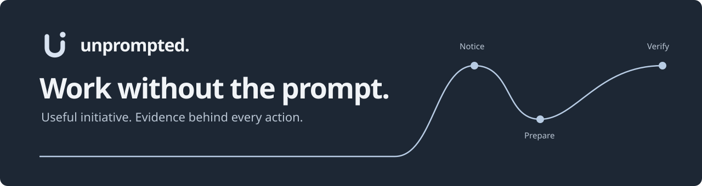

<p align="center"></p>

# Unprompted

**An agent that works in the background while you work, and only asks when a decision is yours.**

Unprompted watches the sources you authorize, notices work nobody assigned it,
checks the evidence, and prepares the next action. You don't write prompts or
manage it. You open it when something needs you, and every result it reports
has been verified, not assumed.

[简体中文](README.zh-CN.md) · [Quick start](#quick-start) · [Docs](docs/README.md) · [Contribute](CONTRIBUTING.md) · [Report a bug](https://github.com/PStarH/unprompted/issues/new/choose)

[](https://github.com/PStarH/unprompted/actions/workflows/ci.yml)
[](LICENSE)
[](package.json)

<p align="center"></p>

## How it works

A meaningful change in your context is the trigger, not a new prompt.

```text
An email arrives → a commitment is discovered → evidence changes
                → a reply is prepared → you approve → the result is verified
```

- **It notices existing work.** Requests are discovered from authorized events.
- **It follows the evidence.** Missing or stale information keeps work open.
  A newer result can withdraw a prepared draft automatically.
- **It does the preparation.** The next action comes with its document,
  sources and checked requirements, ready for review.
- **It knows when to ask.** External actions need your approval or an
  explicitly scoped standing authorization. Uncertain outcomes are reconciled
  before any retry.

## What you see

The interface is built to take as little of your attention as possible.

- **Work** is one number, one sentence about what the agent is doing, and four
  zones that always stay in place: *Needs you*, *In motion*, *Waiting*, and
  *Watching · paused · done*. Below them, it shows which sources it is watching,
  what it did most recently, and how much it remembers.
- **A task** opens as its own page. On wide screens a compact task index stays
  beside it, and the left/right arrow keys move between cards. The outcome
  comes first; an unconfirmed result is never shown as done. Each requirement
  is listed with the evidence that satisfied it, next to the task's own
  history.
- **Memory** groups what the agent learned by project and deliverable. You can
  edit, delete or restore any memory.
- **Connections** states each source's access in words: read on, modify on or
  off. Read access is the starting permission.

<p align="center"></p>

Nothing moves on its own. New tasks and live updates never open details, steal
focus or interrupt typing.

## Quick start

**Try it without any account:**

```sh
git clone https://github.com/PStarH/unprompted.git
cd unprompted
npm ci --include=optional
npm run demo
```

The demo is a disposable local simulation. It does not use saved accounts or
contact external services.

**Use your own work:** run `npm start` instead (Node.js 20+). Open the address
printed after **Ready**. Enter your model provider's endpoint, model ID and API
key, then choose **Verify and connect model**. Local compatible models can work
without a key. Only a successful real inference saves the key; no restart is
needed.

Then connect a source on the same page:

- **Local folders** need no cloud account: select a folder of Markdown or text.
- **Apple Notes** (macOS) asks for Automation permission. Real-account
  acceptance is still pending.
- **Google, GitHub, Outlook, Slack and Notion** use your provider account.
  GitHub uses device authorization; Outlook, Slack and Notion open the
  provider's consent page.

[Source permissions and limits →](docs/CONNECTORS.md)

Authorization starts the first read immediately. The page reports the actual
emails, documents and work it found, and an empty result stays empty. **Normal
startup never plays a sample or invents tasks.**

<details>
<summary><strong>macOS app (Apple silicon)</strong></summary>

Download `Unprompted-0.3.0-macos-arm64.zip` from
[Releases](https://github.com/PStarH/unprompted/releases), check it with
`shasum -a 256 -c Unprompted-0.3.0-macos-arm64.zip.sha256`, unzip, and move
`Unprompted.app` to `/Applications`. The app is ad-hoc signed, not notarized.
On first launch, right-click it and choose **Open**, or run
`xattr -dr com.apple.quarantine /Applications/Unprompted.app`. Run it from an
APFS disk; launching from an exFAT external drive can hang. Your data is kept in
`~/Library/Application Support/Unprompted` and is not removed when you delete
the app.
</details>

<details>
<summary><strong>Google, MCP tools, ports</strong></summary>

For Google, a distribution with a registered Desktop OAuth client opens Google
consent directly. A self-hosted checkout without that client guides you through
the one-time Google Cloud setup and accepts its downloaded JSON.

External MCP tools are available in **Connections → MCP** after
`npm ci --include=optional` and a restart. Connect a remote URL or paste a
`mcpServers` config for HTTP, stdio or legacy SSE.
[MCP setup and scope →](docs/CONNECTORS.md#external-mcp-tools)

The interface supports English and Chinese. A busy default port is replaced
automatically; `npm start -- --port 4180` chooses a specific port.
[Download a source ZIP](https://github.com/PStarH/unprompted/archive/refs/heads/main.zip)
if you prefer not to use Git.
</details>

## Safety and privacy

- Sources start **read-only**. Sending and document edits stay off until you
  opt in to each one separately. Automatic observation can be paused.
- If the model fails, that work stays unready; rules never silently stand in
  for a successful model reading.
- The server binds to `127.0.0.1` and has no authentication. Run it on your own
  machine. Email, document and task content are sent to the model you choose.
- The local database, tokens and model keys are **not encrypted**.
- Disconnecting stops new reads and keeps the saved copy. **Disconnect and
  clear** deletes that source's local inbox, tasks, snapshots and derived
  records.

More: [local setup](docs/ONBOARDING.md) · [connectors](docs/CONNECTORS.md) ·
[Gmail and Drive](docs/LIVE_INTEGRATION.md) ·
[configuration and data handling](docs/CONFIGURATION.md) · [API](docs/API.md)

## What works today

This is a **local first version** for one person, on one machine, in one
process. Real-world usefulness and error rates still need user feedback.
[Product direction](docs/PRODUCT_DIRECTION.md)

| Area | Current scope |
| --- | --- |
| Context | Email requests, GitHub issues, pull requests, commits, Actions runs, document updates and run records |
| Local sources | Selected Markdown/text folders (explicit to-dos) and macOS Notes; note creation requires a separate folder grant, and real-account acceptance is pending |
| GitHub | Device OAuth; assigned issues, review requests, repository commits and Actions runs; read-only |
| Microsoft Outlook | Browser OAuth with PKCE, inbox delta sync and model-backed request discovery; draft creation requires separate authorization |
| Slack | Browser OAuth with PKCE, direct and group direct messages; read-only |
| Notion | Browser OAuth, pages selected during consent; child-page creation requires a separate parent-page grant |
| Google Workspace | Optional Gmail / Drive / Docs connector; draft creation, sending and document edits require separate authorization |
| MCP tools | External HTTP/stdio/SSE services, per-tool read grants, task investigation and call history |
| Live sending | Implemented, explicitly gated, and covered by scripted tests; not claimed as validated in production |
| Task management | Trusted commitment revisions/withdrawals, persisted waits, reversible corrections and shared dependencies |
| Document changes | Source-backed, version-checked patches with separate authorization and readback |
| Local app | Browser OAuth setup, continuous observation controls and an unsigned macOS app builder |
| Storage | One user, one process, SQLite WAL + FTS5. Local files, tokens and model keys are not encrypted |

Google, GitHub, Outlook, Slack and Notion need an OAuth client you register, or
a build that already includes one. This repository does not ship a public
client ID. Read-only use on a live account is for you to confirm; it is not
claimed as production-validated here.

Built-in Calendar, general desktop control, unrestricted autonomous rewriting
and a hosted multi-user service are not implemented.
[Architecture and limitations →](docs/ARCHITECTURE.md)

<details>
<summary><strong>Durable execution and bounded learning (v0.3)</strong></summary>

The [v0.3 implementation baseline](docs/PRD.md) adds persisted jobs, fresh task
checkpoints, external-write intents and resource claims. Interrupted writes are
reconciled before retry. Memory, explicit rules and learned Experiences remain
separate; learned guidance never grants a tool permission. Automatic promotion
starts off. Manage memories and rules in **Memory**, and quiet hours in
**Settings**. **Forget** removes dependent local data and cancels dependent
work; the result reports unresolved provider operations and retention limits.

The default local retrieval combines FTS5 and in-process lexical vectors; a
local semantic encoder can be supplied through the framework API. This is not a
claim of neural semantic retrieval. Existing JSON workspaces migrate on first
open, with a private backup retained until Forget or explicit removal.
[Storage and recovery details](docs/ARCHITECTURE.md#storage-and-process-model)
</details>

## Build it with us

Run a complete framework workflow without a server, account or model:

```sh
npm run example
npm run example -- --approve
```

The first command discovers a follow-up and prepares a reply while keeping
sends at zero. The second explicitly approves one **simulated** delivery,
verifies its receipt and checks that a duplicate event does not resend it.
Edit [the example](examples/first-workflow.mjs) to change the request or
evidence.

```text
Connector events → WorkEngine → evidence / policy → provider → verified result
                      ↕
                  local store
```

[Extend your first workflow](docs/EXTENDING.md) explains the extension
boundaries, contracts and tests. The optional
[Pi harness](docs/CONFIGURATION.md#pi-tool-loop) adds bounded document-reading
tool calls; it requires Node.js 22.19+ and the optional packages. The core
example and demo require neither.

- New to the code? Start with the [contributor guide](CONTRIBUTING.md) and
  [good first issues](https://github.com/PStarH/unprompted/issues?q=is%3Aissue%20is%3Aopen%20label%3A%22good%20first%20issue%22).
- Found a problem? [Open a bug report](https://github.com/PStarH/unprompted/issues/new/choose)
  with synthetic reproduction data.
- Have a scenario or idea? [Share it](https://github.com/PStarH/unprompted/issues/new/choose),
  including what should trigger discovery and what evidence would justify action.
- Working on a change? `npm run test:workflow` is a short first check;
  [testing docs](docs/TESTING.md) explain the full suite and evaluations.

Documentation, accessibility, reproducible scenarios and regression tests are
all useful contributions. No separate contributor agreement is required.

## License

[Apache-2.0](LICENSE). See [NOTICE](NOTICE) for attribution and
[SECURITY.md](SECURITY.md) for private vulnerability reporting.
