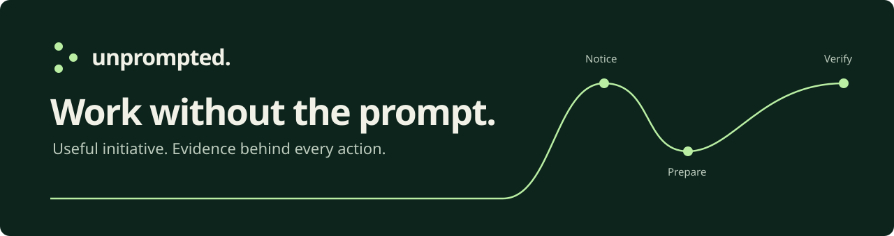
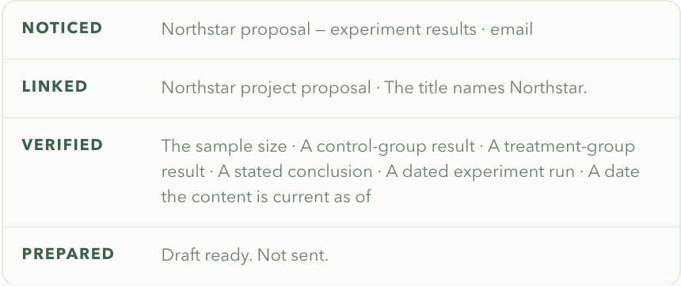

<p align="center"></p>

# Unprompted

**一个主动发现值得处理的事，并推动它向前发展的 AI Agent。**

Unprompted 关注你授权环境中的变化，关联已有工作、核对证据、准备下一步行动。
你只在真正需要决策时参与，不必为每件事重新下达指令。

[English](README.md) · [立即体验](#一分钟体验) · [文档](docs/README.md) · [参与贡献](CONTRIBUTING.md) · [反馈问题](https://github.com/PStarH/unprompted/issues/new/choose)

## 一分钟体验

准备好 **Node.js 20+** 和 Git，推荐 Node.js 22 或更新版本。
无需 API Key、连接账号、安装依赖或构建。

```sh
git clone https://github.com/PStarH/unprompted.git
cd unprompted
npm run demo
```

打开 **[http://127.0.0.1:4173](http://127.0.0.1:4173)**，等待约 15 秒。
场景会自行开始：

1. 一封邮件请 Maya 更新提案；Unprompted 自行发现需要跟进的工作。
2. 文档发生变化；系统检查要求是否满足、结果是否与最新记录一致，并忽略无关修改。
3. 证据齐全后，准备好回复和文档链接。
4. 点击 **Approve simulated send**，动作进入本地模拟发件箱，核验模拟回执后才标记完成。

**演示完全在本地运行，使用模拟数据。** 它会忽略 Google 和模型凭据，使用新的临时工作区，不向外发送邮件。
点击 **Replay scenario** 可重播，按 **Ctrl+C** 停止。
端口被占用时，运行 `npm run demo -- --port 4180`。

[首次运行与常见问题 →](docs/QUICKSTART.md)

## 主动性体现在哪里？

推动工作的是上下文中的变化：

```text
邮件到达 → 发现承诺 → 证据更新 → 准备回复 → 由你批准 → 核验结果
```

- **主动发现**：从授权环境的事件中识别已有工作，不必再向 Agent 交办一次。
- **持续核对**：缺少或过期的证据会让工作保持未完成；新结果出现时，旧草稿可以自动撤回。
- **主动准备**：回复、文档链接、来源和已核对的要求一起备好，供你审阅。
- **适时询问**：对外动作需要批准，或你事先明确授予、范围匹配的权限；结果未知时先核实，再决定是否重试。

<details>
<summary>查看当前应用里的推理链</summary>



这是运行中原型的界面，使用内置模拟场景。

</details>

## 当前能做什么？

这是一个**早期、本地优先的原型**。事件引擎、证据核对、审批、持久化、界面以及模拟工作闭环已经实现。
默认体验采用确定性逻辑，外部模型是可选配置。

| 模块 | 当前范围 |
| --- | --- |
| 本地演示 | 自动开始、核对证据、准备回复、模拟审批与核验 |
| 上下文 | 邮件请求、文档变更、运行记录 |
| Google Workspace | 可选 Gmail / Drive / Docs 连接器，有只读配置指引 |
| 真实发送 | 已实现并有脚本测试覆盖，需显式开启；不宣称已完成生产环境验证 |
| 存储 | 单用户、单进程、本地 JSON 状态 |

尚未实现日历、Slack、通用桌面控制、自主编辑文档或托管多用户服务。
真实场景的价值与误报率还需要大家反馈。[架构与局限 →](docs/ARCHITECTURE.md)

## 接入自己的工作环境

`npm start` 启动普通运行模式，**默认开启只读 shadow mode**。
未配置凭据时使用本地模拟。Google 接入独立于一键演示：

- [连接 Gmail 和 Drive](docs/LIVE_INTEGRATION.md)
- [配置与数据处理](docs/CONFIGURATION.md)
- [API 文档](docs/API.md)

服务仅绑定 `127.0.0.1`，没有登录鉴权，适合在自己的电脑运行。
如开启外部模型，相关请求内容可能发送给模型提供方；默认演示不会调用模型。

## 一起参与

给项目一个 **Star**，在本地**跑一次**，或者提交一项**贡献**。

- 第一次参与：从[贡献指南](CONTRIBUTING.md)和
  [good first issues](https://github.com/PStarH/unprompted/issues?q=is%3Aissue%20is%3Aopen%20label%3A%22good%20first%20issue%22) 开始。
- 遇到问题：用[问题模板](https://github.com/PStarH/unprompted/issues/new/choose)提供模拟数据和复现步骤。
- 分享场景：说明什么变化应该触发发现、什么证据足以支持行动。
- 修改代码：先运行 `npm run test:workflow`，再参照[测试指南](docs/TESTING.md)完成对应检查。

文档、无障碍体验、可复现场景和回归测试都欢迎。不需要单独签署贡献者协议。

## 许可证

[Apache-2.0](LICENSE)。署名见 [NOTICE](NOTICE)，安全漏洞请按 [SECURITY.md](SECURITY.md) 私下报告。
