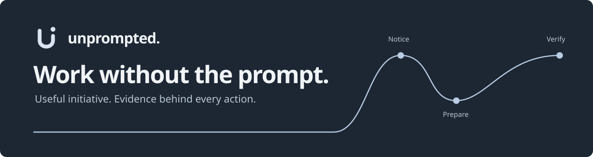
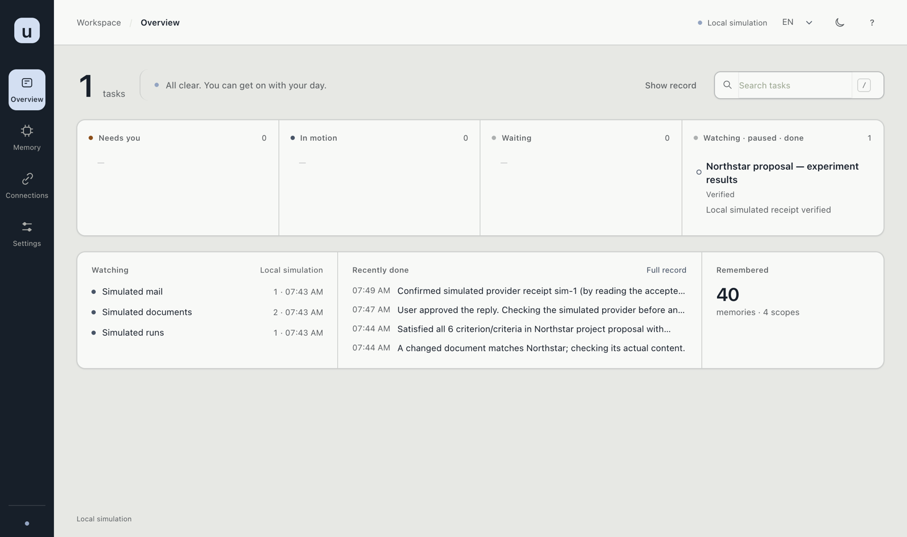
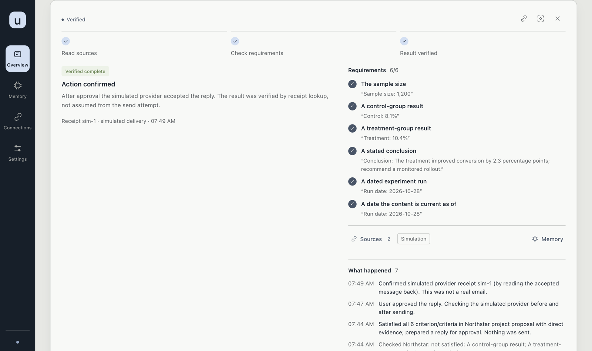

<p align="center"></p>

# Unprompted

**在你工作时于后台分担工作的 Agent，只在需要你做决定时才找你。**

Unprompted 留意你授权的来源，发现没人交办但值得处理的事，核对证据，准备好下一步。
你不需要写提示词，也不需要管理它。有事需要你时再打开看；它报告的每个结果都经过核验，而不是推测。

[English](README.md) · [立即体验](#快速开始) · [文档](docs/README.md) · [参与贡献](CONTRIBUTING.md) · [反馈问题](https://github.com/PStarH/unprompted/issues/new/choose)

<p align="center"></p>

## 如何工作

推动工作的是上下文中的变化，而不是新的提示词：

```text
邮件到达 → 发现承诺 → 证据更新 → 准备回复 → 由你批准 → 核验结果
```

- **主动发现**：从授权环境的事件中识别已有工作，不必再向 Agent 交办一次。
- **持续核对**：缺少或过期的证据会让工作保持未完成；新结果出现时，旧草稿可以自动撤回。
- **主动准备**：回复、文档链接、来源和已核对的要求一起备好，供你审阅。
- **适时询问**：对外动作需要批准，或你事先明确授予、范围匹配的权限；结果未知时先核实，再决定是否重试。

## 你会看到什么

界面的目标是尽量少占用你的注意力。

- **工作台**：一个总数、一句说明 Agent 正在做什么的话，以及始终保持在原位的四个区——*需要你*、*进行中*、*等待中*、*观察 · 暂停 · 已结束*。下方显示它正在留意哪些来源、最近做了什么、记得多少事。
- **任务**：单独打开一页。宽屏时旁边保留一条紧凑的任务索引，左右方向键可以切换任务。结果放在最前面；尚未确认的结果绝不会显示为完成。每项要求都附上满足它的证据，旁边是这件事自己的经过。
- **记忆**：按项目与交付物分组，可以编辑、删除或恢复。
- **连接**：用文字写明每个来源的权限——读取开、修改开或关。默认只申请读取。

<p align="center"></p>

界面不会自己动：新任务和实时更新不会自动展开详情、抢走焦点或打断输入。

## 快速开始

**0.4.0 使用自托管网页版**，面向 macOS 与 Windows，也可在 Linux 运行 Node 服务。不需要 App、Docker 或付费服务器。安装 Node.js 22 或更新版本后，在终端或 Windows PowerShell 执行以下命令。Windows 运行验收仍待完成；Apple 备忘录和提醒事项仅支持 macOS。

**不需要任何账号即可体验：**

```sh
git clone https://github.com/PStarH/unprompted.git
cd unprompted
npm ci --include=optional
npm run demo
```

演示是用完即清理的本地模拟，不读取保存的账号，也不会访问外部服务。

**处理自己的工作：** 改为运行 `npm start`（需要 Node.js 20+）。打开终端 **Ready** 后显示的网址，
填写模型提供方的接口地址、模型 ID 和 API Key，点击 **验证并连接模型**。本地兼容模型可以不填 Key。
只有真实推理请求成功后才会保存 Key，无需重启。

接着在同一页连接一个来源：

- **本地文件夹**：无需云账号，选一个包含 Markdown 或文本文件的文件夹即可。
- **Apple 备忘录**（macOS）：需要允许自动化访问；真实账号授权流程仍待人工验收。
- **Google、GitHub、Outlook、Slack、Notion**：使用你的账号授权。GitHub 使用设备授权；Outlook、Slack 和 Notion 打开对方的授权页面。

[连接器配置](docs/CONNECTORS.zh-CN.md) · [开发指南](docs/CONNECTORS.md)

授权后立即开始首次读取。页面显示实际读取的邮件、文档和发现的工作；没有发现时如实显示为空。
**正常启动不会播放样例或生成虚构任务。**

<details>
<summary><strong>旧版 macOS 应用预览（0.3.0，Apple 芯片）</strong></summary>

从 [Releases](https://github.com/PStarH/unprompted/releases) 下载 `Unprompted-0.3.0-macos-arm64.zip`，用
`shasum -a 256 -c Unprompted-0.3.0-macos-arm64.zip.sha256` 校验，解压后把 `Unprompted.app` 移到 `/Applications`。
应用为 ad-hoc 自签名，未经 Apple 公证：首次打开请右键选择**打开**，或运行
`xattr -dr com.apple.quarantine /Applications/Unprompted.app`。请在 APFS 磁盘上运行；从 exFAT 外接盘启动可能卡住。
数据保存在 `~/Library/Application Support/Unprompted`，删除应用不会删除数据。
</details>

<details>
<summary><strong>Google、MCP 工具、端口</strong></summary>

预置了已注册桌面 OAuth 客户端的发行版可直接打开 Google 授权；自行部署且没有预置客户端时，
页面会引导完成一次性的 Google Cloud 设置，并接收下载的 JSON。

外部 MCP 工具可在运行 `npm ci --include=optional` 并重启后，从**连接 → MCP**接入。
输入远程地址或粘贴 `mcpServers` 配置，支持 HTTP、stdio 与旧版 SSE。[MCP 配置与范围](docs/CONNECTORS.zh-CN.md#外部-mcp-工具)

界面支持中英文。默认端口被占用时会自动选择可用端口；也可运行 `npm start -- --port 4180` 指定。
不使用 Git 时，可[下载源码 ZIP](https://github.com/PStarH/unprompted/archive/refs/heads/main.zip) 后运行相同命令。
</details>

## 安全与隐私

- 来源**默认只读**。发送和修改文档分别另行开启；可以随时暂停自动观察。
- 模型失败时这项工作保持未就绪，不会退回规则逻辑并显示可发送。
- 服务仅绑定 `127.0.0.1`，没有登录鉴权，只适合在自己的电脑运行。邮件、文档和任务内容会发送给你选择的模型。
- 本机数据库、令牌和模型密钥**不加密**。
- 断开连接会停止读取，并保留已保存的记录。**断开并清除**会删除这个来源在本机的收件、任务、快照和衍生内容。

更多：[连接器配置](docs/CONNECTORS.zh-CN.md) · [桌面应用与 OAuth（English）](docs/ONBOARDING.md) ·
[Google Workspace 接入（English）](docs/LIVE_INTEGRATION.md) · [本机数据与隐私（English）](docs/CONFIGURATION.md)

## 当前能做什么

这是**本地初版**：一个人、一台电脑、一个进程。真实场景的价值与误报率还需要大家反馈。[产品方向](docs/PRODUCT_DIRECTION.md)

| 模块 | 当前范围 |
| --- | --- |
| 上下文 | 邮件请求、GitHub issue、PR、提交、Actions 运行、文档变更与运行记录 |
| 本机来源 | 指定的 Markdown / 文本文件夹；macOS 备忘录可在另行授权的文件夹新建内容，真实账号验收待完成 |
| GitHub | 设备 OAuth；分配给你的 issue、评审请求、仓库提交与 Actions 运行；只读 |
| Microsoft Outlook | 浏览器 PKCE 授权、收件箱增量同步与模型识别请求；另行授权后可新建草稿 |
| Slack | 浏览器 OAuth（PKCE），读取个人和群组私信；只读 |
| Notion | 浏览器 OAuth，读取授权时选择的页面；另行授权父页面后可新建子页面 |
| Google Workspace | 可选 Gmail / Drive / Docs；创建草稿、发送和文档修改分别授权 |
| MCP 工具 | 接入外部 HTTP / stdio / SSE 服务，逐个工具授权读取，保留任务调查与调用记录 |
| 真实发送 | 已实现并有脚本测试覆盖，需显式开启；不宣称已完成生产环境验证 |
| 主动管理 | 同一承诺修订/撤回、持久化等待、可撤销纠正与共同依赖决策 |
| 文档补丁 | 根据缺项准备有来源的原文补丁，绑定版本授权，应用后读回核验 |
| 本地应用 | 浏览器 OAuth 接入、持续观察控制与未签名 macOS 应用构建器 |
| 存储 | 单用户、单进程、SQLite WAL + FTS5。本机数据库、令牌和模型密钥不加密 |

Google、GitHub、Outlook、Slack 和 Notion 需要注册 OAuth 客户端，或使用已经带上客户端的发行版。
这个仓库不附带公开的 Client ID。真实账号使用仍需验收，这里不把它说成已经完成生产验证。

尚未实现内置日历连接器、通用桌面控制、开放式自主重写或托管多用户服务。[架构与局限 →](docs/ARCHITECTURE.md)

<details>
<summary><strong>v0.3：可靠执行与受限学习</strong></summary>

[实现需求](docs/PRD.md)涵盖持久作业、任务版本与检查点、对外写入意图、资源占用和故障核验。
进程重启或请求超时后，先核验外部结果，再决定是否重试。
记忆、明确规则、学习经验分开管理；经验不能授予工具权限，自动晋升默认关闭。
在**记忆**中管理事实、规则和经验，在**设置**中调整提醒预算与免打扰时段。
**忘记**会清理关联本地数据并取消依赖它的任务，同时如实报告外部操作和备份保留状态。

正常工作区使用 SQLite WAL + FTS5。默认检索结合全文搜索与进程内词法向量，框架可接入本地语义编码器；
默认实现不宣称神经语义检索。旧 JSON 首次打开时迁移，并保留私有备份，执行“忘记”时一并清理。
[持久化与恢复边界](docs/ARCHITECTURE.md#storage-and-process-model)
</details>

## 一起参与

不启动网页、不配置账号或模型，也能直接运行框架的完整工作流：

```sh
npm run example
npm run example -- --approve
```

第一条命令演示主动发现、等待证据和准备回复，发送数量保持为零。
第二条明确授权一次**模拟发送**，核验回执，并检查重复事件不会重复发送。
修改[示例代码](examples/first-workflow.mjs)即可更换请求与证据；[扩展指南](docs/EXTENDING.md)说明实际模块边界、契约和测试入口。

可选 [Pi 内核](docs/CONFIGURATION.md#pi-tool-loop) 提供有预算的文档读取工具循环，需要 Node.js 22.19+ 和可选依赖。基础演示和示例都不需要。

- 第一次参与：从[贡献指南](CONTRIBUTING.md)和
  [good first issues](https://github.com/PStarH/unprompted/issues?q=is%3Aissue%20is%3Aopen%20label%3A%22good%20first%20issue%22) 开始。
- 遇到问题：用[问题模板](https://github.com/PStarH/unprompted/issues/new/choose)提供模拟数据和复现步骤。
- 分享场景：说明什么变化应该触发发现、什么证据足以支持行动。
- 修改代码：先运行 `npm run test:workflow`，再参照[测试指南](docs/TESTING.md)完成对应检查。

文档、无障碍体验、可复现场景和回归测试都欢迎。不需要单独签署贡献者协议。

## 许可证

[Apache-2.0](LICENSE)。署名见 [NOTICE](NOTICE)，安全漏洞请按 [SECURITY.md](SECURITY.md) 私下报告。
