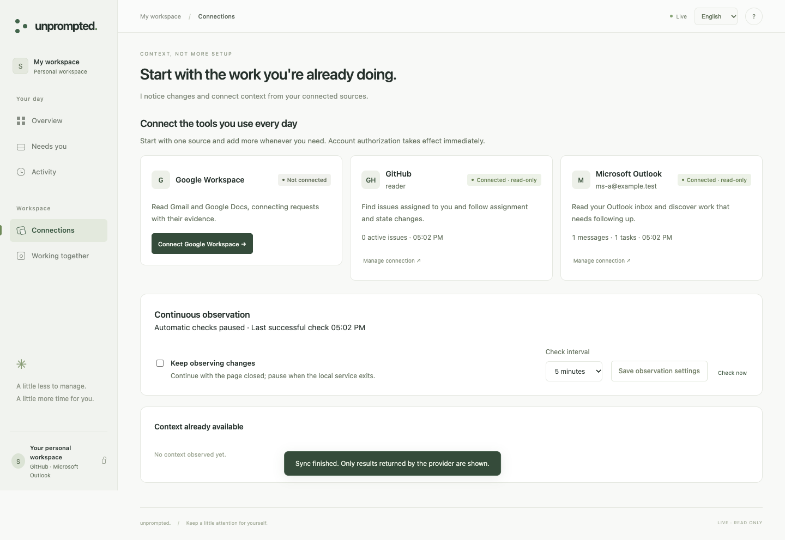

<p align="center"></p>

# Unprompted

**一个主动发现值得处理的事，并推动它向前发展的 AI Agent。**

Unprompted 关注你授权的工作与生活环境中的变化，关联已有工作、核对证据、准备下一步行动。
你只在真正需要决策时参与，不必为每件事重新下达指令。

当前先验证真实用户是否认可未经明确要求的主动发现。邮件与文档是工程验证样本，
产品保持通用伙伴的方向。[产品方向与当前优先级](docs/PRODUCT_DIRECTION.md)

[English](README.md) · [立即体验](#开始使用-agent) · [文档](docs/README.md) · [参与贡献](CONTRIBUTING.md) · [反馈问题](https://github.com/PStarH/unprompted/issues/new/choose)

## 开始使用 Agent

需要 **Node.js 20+**，以及模型提供方的接口地址、模型 ID 和 API Key。
本地兼容模型可以不填 Key。标准内核无需安装依赖或构建。

```sh
git clone https://github.com/PStarH/unprompted.git
cd unprompted
npm start
```

打开终端 **Ready** 后显示的网址；交互式终端也会自动打开浏览器。
填写接口地址、模型 ID 和 Key，点击 **验证并连接模型**。
应用会用虚构内容发送一次真实的结构化推理请求；验证成功才保存并立即生效，无需重启。
Key 只保存在本机，不会由 API 回传。

接着在同一页选择 **Google Workspace、GitHub 或 Microsoft Outlook**。GitHub 和 Outlook
使用官方设备 OAuth：复制短授权码，在官方页面确认后自动生效，无需手工粘贴访问令牌。
可以同时连接多个来源，也可以单独断开其中一个。[连接器配置与开发指南](docs/CONNECTORS.md)。

Google 接入方面，预置了已注册桌面 OAuth 客户端的发行版可直接打开 Google 授权；
自行部署且没有预置客户端时，页面会引导完成一次性的 Google Cloud 设置，并接收下载的 JSON。
无需复制 refresh token，也无需重启服务。

授权后立即切换到该账号独立的真实工作区，开始读取近期邮件和现有 Google Docs，交给已连接的模型理解。
页面显示实际读取的邮件、文档和发现的工作；没有发现任务时如实说明。**正常启动不会播放样例或生成虚构任务。**

首次只申请读取，可以随时暂停观察。发送邮件与修改文档另行开启；每项操作仍需匹配你的批准或已有授权。
模型失败时任务不会退回规则逻辑并显示可发送。

界面支持中英文。默认端口被占用时会自动选择可用端口；也可运行 `npm start -- --port 4180` 指定。
不使用 Git 时，可[下载源码 ZIP](https://github.com/PStarH/unprompted/archive/refs/heads/main.zip) 后运行相同命令。

### 单独查看规则示例

`npm run demo` 是明确标注的**本地规则示例**，不调用模型、不读取保存的账号、不产生外部效果。
它用于检查框架契约，不代表真实模型 Agent 的能力。

[首次运行与常见问题 →](docs/QUICKSTART.md)

## 主动性体现在哪里？

推动工作的是上下文中的变化：

```text
邮件到达 → 发现承诺 → 证据更新 → 准备回复 → 由你批准 → 核验结果
```

- **主动发现**：从授权环境的事件中识别已有工作，不必再向 Agent 交办一次。
- **持续核对**：缺少或过期的证据会让工作保持未完成；新结果出现时，旧草稿可以自动撤回。
- **主动准备**：回复、文档链接、来源和已核对的要求一起备好，供你审阅。
- **适时询问**：对外动作需要批准，或你事先明确授予、范围匹配的权限；结果未知时先核实，再决定是否重试。

<details>
<summary>查看当前应用的连接界面</summary>



这是运行中的连接界面，截图使用合成账号。

</details>

## 当前能做什么？

这是一个**早期、本地优先的原型**。事件引擎、证据核对、审批、持久化、界面以及模拟工作闭环已经实现。
主要体验需要接入自己的模型；规则示例单独提供。

| 模块 | 当前范围 |
| --- | --- |
| 本地演示 | 自动开始、核对证据、准备回复、模拟审批与核验 |
| 上下文 | 邮件请求、原生 GitHub issue、文档变更、运行记录 |
| GitHub | 官方设备 OAuth、分配给自己的 issue、更新及改派跟进；只读 |
| Microsoft Outlook | 官方设备 OAuth、收件箱增量同步、模型理解邮件请求；只读 |
| Google Workspace | 可选 Gmail / Drive / Docs 连接器，有只读配置指引 |
| 真实发送 | 已实现并有脚本测试覆盖，需显式开启；不宣称已完成生产环境验证 |
| 主动管理 | 同一承诺修订/撤回、持久化等待、可撤销纠正与共同依赖决策 |
| 文档补丁 | 根据缺项准备有来源的原文补丁，绑定版本授权，应用后读回核验 |
| 本地应用 | 浏览器 OAuth 接入、持续观察控制与未签名 macOS 应用构建器 |
| 存储 | 单用户、单进程、本地 JSON 状态 |

尚未实现日历、Slack、Notion、通用桌面控制、开放式自主重写或托管多用户服务。
真实场景的价值与误报率还需要大家反馈。[架构与局限 →](docs/ARCHITECTURE.md)

## 接入自己的工作环境

`npm start` 打开持久化模型与 Google 设置，用于处理**自己的真实工作**。Google **默认只读**。
首次连接、首轮观察、增量权限、暂停、重试和断开均可在界面完成，无需重启；不同 Google 账号使用独立工作区：

- [本地应用与浏览器接入](docs/ONBOARDING.md)
- [选择或开发连接器](docs/CONNECTORS.md)
- [连接 Gmail 和 Drive](docs/LIVE_INTEGRATION.md)
- [配置与数据处理](docs/CONFIGURATION.md)
- [API 文档](docs/API.md)

服务仅绑定 `127.0.0.1`，没有登录鉴权，适合在自己的电脑运行。
工作上下文会发送给所选模型提供方。显式运行的规则示例不调用模型。

## 一起参与

不启动网页、不配置账号或模型，也能直接运行框架的完整工作流：

```sh
npm run example
npm run example -- --approve
```

第一条命令演示主动发现、等待证据和准备回复，发送数量保持为零。
第二条明确授权一次**模拟发送**，核验回执，并检查重复事件不会重复发送。
修改[示例代码](examples/first-workflow.mjs)即可更换请求与证据；
[扩展指南](docs/EXTENDING.md)说明实际模块边界、契约和测试入口。

可选 [Pi 内核](docs/CONFIGURATION.md#pi-tool-loop) 提供有预算的文档读取工具循环，
需要 Node.js 22.19+ 和可选依赖。基础演示和示例都不需要。

欢迎试用后指出应该发现却没有发现的事，也欢迎提交小而具体的改进。

- 第一次参与：从[贡献指南](CONTRIBUTING.md)和
  [good first issues](https://github.com/PStarH/unprompted/issues?q=is%3Aissue%20is%3Aopen%20label%3A%22good%20first%20issue%22) 开始。
- 遇到问题：用[问题模板](https://github.com/PStarH/unprompted/issues/new/choose)提供模拟数据和复现步骤。
- 分享场景：说明什么变化应该触发发现、什么证据足以支持行动。
- 修改代码：先运行 `npm run test:workflow`，再参照[测试指南](docs/TESTING.md)完成对应检查。

文档、无障碍体验、可复现场景和回归测试都欢迎。不需要单独签署贡献者协议。

## 许可证

[Apache-2.0](LICENSE)。署名见 [NOTICE](NOTICE)，安全漏洞请按 [SECURITY.md](SECURITY.md) 私下报告。
