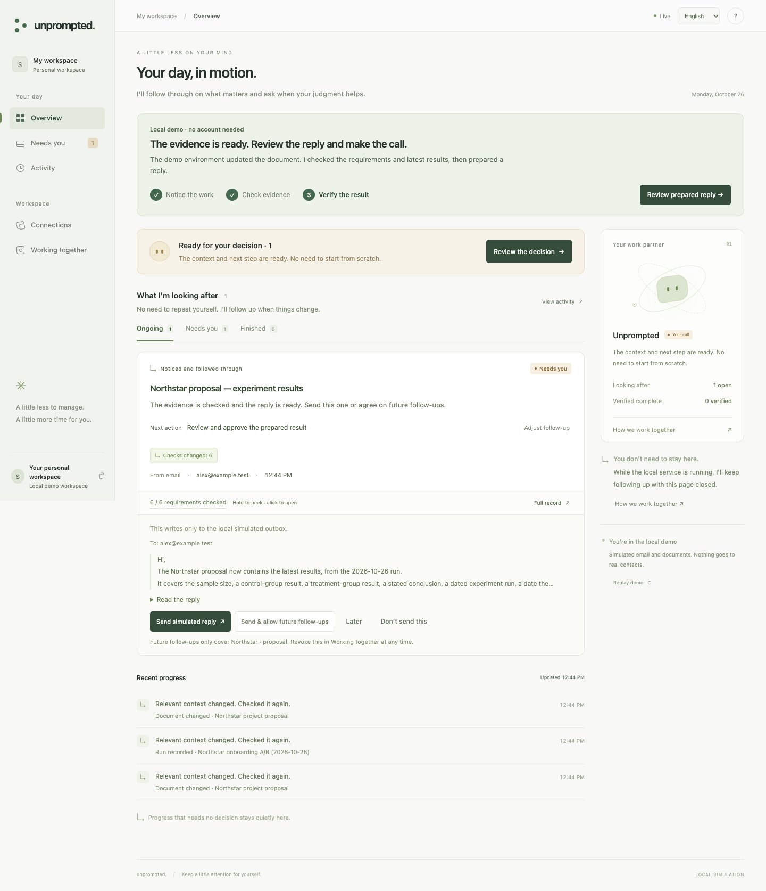

# First run

[← Documentation](README.md)

## Requirements

- Node.js **20+** with npm; **22+** is recommended.
- Git to clone the repository. A source ZIP works too: extract it and open a
  terminal inside the extracted directory.
- A browser, a model endpoint/model ID/API key (optional key for compatible local models),
  and an account for Google, GitHub or Microsoft Outlook.
- Registered provider applications, supplied by your distribution or configured
  once for self-hosting using the [connector guide](CONNECTORS.md). No `npm install` or build is required
  for the standard harness.

Check Node with `node --version`.

## Start the model-backed agent

```sh
git clone https://github.com/PStarH/unprompted.git
cd unprompted
npm start
```

Open the address after **Ready**. Enter your provider's API endpoint, model ID
and API key; compatible local models may omit the key. **Verify and connect
model** sends a real structured request using invented content. A failed request
leaves the previous connection unchanged. Successful verification saves the
connection privately, clears the key field and applies it without restarting.

Choose a source on the same page. GitHub and Outlook use official device OAuth:
select Connect, copy the short code and confirm it on the official sign-in page.
Both connections start read-only and activate without restarting.

For Google, use its connection card. If a Desktop OAuth client is provisioned,
choose **Connect Google**. Otherwise, follow the three in-app Google Cloud steps,
download a Desktop app client JSON, and choose **Import and connect Google**.
The import continues directly to authorization. A blocked popup has a regular
link fallback.

Choose the account and allow the selected read access. The page activates the
connection without restarting and immediately reads recent email and existing
Google Docs. The counts and discovered work reflect actual provider responses.
Read access starts with no sending or document edits. Leave automatic
observation on to check periodically, or pause it in Connections.

Normal mode never plays a sample, including after connecting a model or reloading.
If a service fails, its status includes retry or reconnection guidance. Work
requires successful model reading; failed inference does not become a rule-only
ready action. [Detailed Google setup and recovery](LIVE_INTEGRATION.md).

The launcher handles a busy default port. You can choose one with
`npm start -- --port 4180`. The connection form and settings support English and
Chinese. Your key is stored outside workspace records and is not returned by
the API or SSE stream. See [model configuration](CONFIGURATION.md#connect-your-model).

## Inspect the rule-only example

The following demo deliberately makes no model calls. It is a reproducible
engine example, separate from the model-backed first-use path.

```sh
git clone https://github.com/PStarH/unprompted.git
cd unprompted
npm run demo
```

Open the address printed after **Ready**, normally **http://127.0.0.1:4173/**.
An interactive terminal opens your browser automatically. Use `--no-open` to
disable that or `--open` to request it explicitly. If the default port is busy,
the launcher selects another and prints the actual address.
These commands work in macOS / Linux terminals
and Windows PowerShell; no shell-specific environment assignment is needed.

The launcher creates a fresh temporary workspace on every run, ignores Google
and model configuration, and permits approval only against the local simulated
provider. Your normal saved workspace is not used. Temporary data is removed
when the demo exits normally.

## What you will see

The Northstar scenario starts when the page connects, and takes about 15 seconds
to reach a prepared action. Reading the terminal or this guide does not consume
the story. A progress strip explains each stage. Your browser language selects
English or Chinese; the language control remembers your choice.

| When | Environment change | What Unprompted does |
| --- | --- | --- |
| Start | A proposal exists with results pending | Observes the document |
| ~2 seconds | Alex emails Maya about updating and returning it | Discovers the request and checks what is missing |
| ~5 seconds | An unrelated document changes | Observes and ignores it |
| ~9 seconds | Partial results arrive in the proposal | Checks the document and keeps the work open |
| ~12 seconds | A completed run is registered | Reconsiders whether the results are current |
| ~15 seconds | The complete proposal arrives | Verifies requirements and prepares a linked reply |
| Your choice | **Review prepared reply**, then **Send simulated reply** | Records the local action and verifies its simulated receipt |

The proposal updates are inputs from the environment. The demo does not claim
that the agent edited the proposal itself. All events and receipts are labelled
as simulated.



Choose **Review prepared reply** to read the reply and recipient before sending.
After verification, **See verified result** opens the actual simulated receipt.
**Full record** opens the evidence, requirements, freshness and source document.
**Send & allow future follow-ups** records a standing authorization scoped to the
current project and deliverable; **Working together** lets you revoke it.
**Don't send this** keeps your decision and sends nothing. **Replay demo** starts
over; no task entry or analysis button is needed. A reload keeps the current
story and never resends a completed action.

To try your own account, stop the demo first and run `npm start`. Account setup
belongs to that persistent workspace. The disposable demo shows these next steps
instead of collecting connection settings that would be removed on exit.

Want to contribute? `npm run example` runs a complete local workflow without a
browser. [The extension guide](EXTENDING.md) maps its code to the engine.

## Normal mode

Stop the demo with **Ctrl+C**, then run:

```sh
npm start
```

Normal mode saves private configuration in the operating system’s Unprompted
configuration directory. Authorized Google accounts use separate local JSON
workspace files identified by a hash of the verified account ID. The model
configuration is separate from workspace records. With no connected sources,
the workspace waits for setup; it does not invent work. Additional sources use
account-namespaced IDs; changing or disconnecting an account retires its active
work while preserving the local historical record.

For account connections, read [Google Workspace setup](LIVE_INTEGRATION.md).
For environment loading, ports, model configuration, and storage, see
[Configuration](CONFIGURATION.md).

## Troubleshooting

| Symptom | What to do |
| --- | --- |
| `node` or `npm` is not found | Install Node.js, reopen your terminal, and run `node --version`. |
| `ENOENT` / `package.json` not found | Change into the directory containing this project's `package.json`. |
| Port 4173 is busy | The default demo chooses another port; use the printed address. An explicitly requested busy port fails with a command to try. |
| A reply is prepared but cannot send | In Connections, enable the Gmail send permission if you want approved replies delivered. Reading and preparation work without it. |
| Nothing appears in normal mode | Check that the model and Google are connected, inspect actual read counts, and choose Check now. Zero discoveries can be a valid result. The explicit demo has its own Replay control. |
| `STATE_LOCKED` | Another normal-mode process owns that state file. Stop that process or use a different state file. Don't delete an active lock. |
| Browser cannot connect | Use the exact `http://127.0.0.1:PORT/` address printed by the process. The server is local to the machine running it. |
| `.env` changes have no effect | `npm start` does not automatically read `.env`; use the explicit command in the [configuration guide](CONFIGURATION.md#loading-a-local-env-file). The demo intentionally ignores those credentials. |

Still stuck? [Open a bug report](https://github.com/PStarH/unprompted/issues/new/choose)
with your Node version, OS, command, and error text. Leave out credentials,
real email content, and state files.
